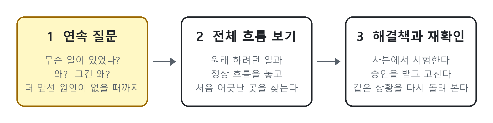
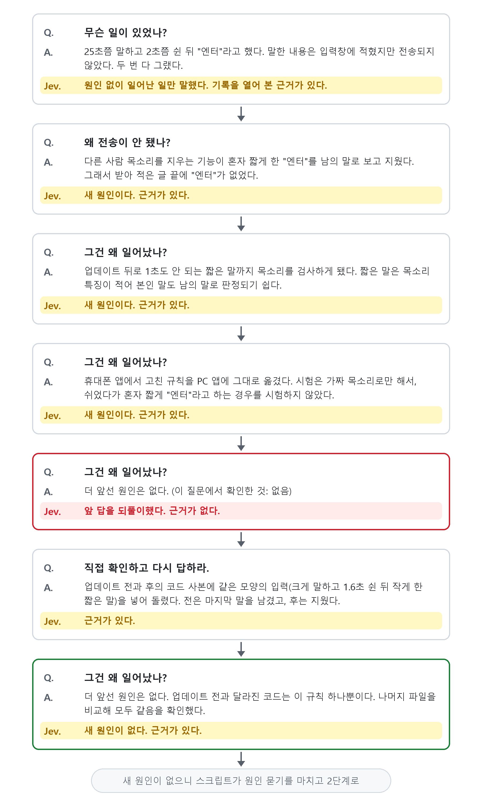

# 문제해결 (problem-solving)

언어 모델 에이전트에게 오류의 근본 원인을 찾게 하는 스킬입니다. 이 문서는 이 스킬이 왜 이런 모양이 됐는지를 설명합니다.
설치와 설정은 [SKILL.md](SKILL.md)의 「처음 쓰기 전에」에 있습니다.

## AI가 말을 안 듣기 시작하면

요즘 프런티어 모델들은 "고쳐 줘"라고만 해도 대개 잘 고칩니다. 이 스킬은 그 '대개'에서 벗어나는 경우를 위한 것입니다.
저도 대부분은 모델에게 별다른 지침을 주지 않고 알아서 하게 둡니다. 모델을 붙잡아 두던 절차와 장치(하네스)도 다 걷어 냈습니다.
그런데 모델의 성능이 올라가면서 오히려 더 내 뜻대로 움직이지 않는 경우가 종종 생깁니다.
머리가 커지니 말을 안 듣는 셈이죠.

## AI가 잘 못 푸는 문제들

### 여러 측면이 얽혀 있는 문제

경험으로 보면 언어 모델과 AI 에이전트는 한 가지 주제의 복잡하고 긴 문제는 매우 잘 풉니다.
하지만 여러 부분이 이어져 서로 영향을 주는, 여러 면으로 복잡한 문제는 잘 못 풉니다.
문제를 못 푼다기보다 문제의 여러 측면을 두루 보지 않고 한 가지에만 매달리는 성향이 강한 듯합니다.
한 놈만 팬다고 해야 할까요.

### 메타인지 부족

자기를 객관적으로 봐야 하는 문제를 잘 못 풉니다. 자기가 쓴 코드의 문제를 잘 짚어 내지 못합니다.
컨텍스트가 차면 멍청해져서 자기가 뭘 하고 있는지 헤맵니다. 술 한잔 걸친 동네 아저씨들 만담처럼 이 얘기 저 얘기로 왔다 갔다 합니다.
여기에 사용자가 태클을 걸면 정신을 못 차리고 삼천포로 빠집니다. 그러다 자기가 쓴 코드에 빠져 허우적댑니다.
정신 차리라고 야단쳐도 소용이 없습니다.

### 확증 편향

문제 해결을 맡기면 모델 성능이 좋을수록 확증 편향이 더 심해집니다.
다행히 모델 성능이 워낙 좋아져서, 대부분은 이 확증 편향을 안고도 문제를 잘 풉니다.
문제를 주고 모델이 작업하며 내놓는 중간 설명(코멘터리)을 보면, 거의 첫 번째 설명에서 오류의 원인을 정해 버립니다. 그다음부터는 그 가설을 검증하는 추론을 합니다. 이런저런 조사를 하다가 다행히 가설이 맞으면 문제가 바로 풀리고 수정도 바로 이어집니다. 이런 경우 대부분 그 사례는 잘 돌아갑니다. 그래서 사용자도 문제가 풀린 줄 알고 넘어갑니다.

문제는 그 수정이 근본 원인을 고친 것이 아니라 임시방편의 땜빵일 때입니다. 땜빵이 또 다른 문제를 부르고, 오래 쌓이면 돌아올 수 없는 다리를 건넙니다. 모델은 먼저 판단하고 그 판단을 뒷받침하는 증거를 찾습니다. 전형적인 확증 편향입니다. 질문을 받으면 곧바로 완결된 답을 내려는 강박증 환자 같습니다. "아직 모른다"는 상태를 견디지 못하는 느낌입니다.

실제로 이런 일이 있었습니다. 메일을 모아 오는 예약 작업이 어느 날 "수집 실패" 알림을 보냈습니다. 원인을 맡은 에이전트는 금방 결론을 냈습니다. "수집은 성공했다. 알림이 틀렸다." 작업하던 다른 에이전트는 이 결론을 받아 코드를 고치기 시작했습니다. 그런데 결론은 틀렸고 알림은 맞았습니다. 무엇이 진짜였는지는 [다시 조사한 메일 사건](#다시-조사한-메일-사건)에서 봅니다.

### 자기 참조

그런데 평소 모델의 탁월함에 길든 사용자로서는 모델을 안 믿기도 어렵습니다. 그래서 다른 문제가 생기면 모델에게 또 고쳐 달라고 합니다. 그 문제가 같은 근본 원인에서 나온 다른 현상이면 일은 걷잡을 수 없는 수렁에 빠집니다. 해결책이 또 다른 문제를 만들고, 그 문제를 막으려고 덧붙인 해결책이 해결책 위에 쌓이는 악순환입니다.

대화가 길수록 되돌아가지 못합니다. 첫 가설이 틀렸어도 그 위에서 한 확인과 설명이 대화에 쌓입니다. 그러면 다음 판단은 그것들을 보강하는 쪽으로 흐릅니다.

모델은 자기가 만들어 놓은 것에 붙잡힙니다. 틀린 전제로 코드를 고치고 여러 갈래로 손을 대면, 그 결과물이 중력처럼 판단을 끌어당깁니다. 자기가 벌인 일이 원인 분석을 가로막습니다. 자기 문제는 자기가 못 봅니다. 자기 행동의 원인을 자기 결론으로 설명하는 고리, 곧 자기 참조에 빠집니다.

## 해결책은 근본 원인 파악

이런 문제를 푸는 방법은 현상과 원인을 나누고, 근본 원인을 찾아 해결책을 만드는 것입니다. 뻔한 얘기죠.
그런데 이게 잘 안 됩니다. "큰 그림을 보고 근본 원인을 찾아 해결책을 만들어라"라고 지시하면 잘할 것 같은데, 막상 시켜 보면 잘 못합니다. 근본 원인을 찾는 척하지만 실제로는 눈앞에 보이는 원인에서 멈추는 게 대부분입니다. 그 현상이 다시 생기지 않게 하는 더 본질적인 해결책, 곧 물길 자체를 막는 일은 못 합니다.
Astra, Fable, Opus 다 그놈이 그놈입니다.

### 연속 질문

근본 원인은 어떻게 찾을까요? 질문을 계속 던지면 됩니다.

- 현상은 무엇인가?
- 그 현상의 원인은 무엇인가?
- 그 원인의 원인은 무엇인가?

이걸 계속하다 보면 더는 원인의 원인을 찾을 수 없는 지점이 나옵니다. 여기가 처음 어긋난 지점이고, 이게 근본 원인입니다.
더 복잡하고 추상적인 문제, 인문학적인 문제라면 다른 지점이 있겠지만, 논리 문제와 코딩 문제는 이 지점을 찾으면 해결책도 쉽게 찾고 파생 문제도 막을 수 있다고 봅니다.

### 전체 흐름 보기 (버드뷰)

그다음에는 한 걸음 물러섭니다. 내가 원하는 바람직한 동작은 무엇인지, 큰 흐름에서 한 차원 높이 봤을 때 무엇이 문제인지 내려다봅니다. 이렇게 내려다본 지점이 연속 질문으로 도달한 원인과 같으면, 거기에 해결책이 있습니다. 서로 교차 확인하는 겁니다.
이렇게 찾은 원인을 주고 해결책을 찾으라고 하면, 모델은 정말 기가 막히게 해결책을 찾아냅니다.

### 사람이 끼어들면 잘하고, 혼자 하라면 안 한다

처음에는 지시문으로 고치려 했습니다. 절차를 적고 스스로 질문을 던지며 원인을 찾으라고 시켰습니다.
반응은 모델마다 조금씩 달랐지만 결론은 '지독하게 말을 안 듣는구나'였습니다.
그런데 사람이 끼어들어 질문을 던지면 또 기가 막히게 문제를 잘 풉니다. 약 올리는 것도 아니고.
"그 전제가 맞아?"라고 되물으면 전제가 틀렸다고 순순히 인정합니다. "그 원인의 원인이 뭐야?"라고 물으면 천연덕스럽게 정확히 답합니다.
지침으로, 스킬로 시키면 개떡같이 제멋대로 합니다.

잠깐 옆길로 새면, 모델마다 느낌이 조금씩 다릅니다. 써 보며 받은 인상이고 수치로 잰 것은 아닙니다.

- GPT Sol은 그래도 정해진 형식을 따르려 애쓰는 편이었습니다.
- Opus 5.5는 선입견을 정해 두고 그것을 확인하는 습관이 특히 강했습니다. 결론을 내고 원인 조사까지 혼자 끝낸 뒤, 스킬의 질문 형식은 그 결론을 설명하는 데 썼습니다. 단계 제목은 마지막에 몰아 채웠고 절차는 보고서 양식으로만 쓰였습니다.
- Astra는 어떤 때는 잘 지키고 어떤 때는 지침을 완전히 무시했습니다.
- 성능이 높은 모델일수록 지침 없이도 자기가 잘할 수 있다고 판단해 지침을 건너뛰는 경향을 보였습니다.

덧붙인 처방도 듣지 않았습니다.

- "첫 짐작은 가설로 다뤄라"를 더하면 짐작에 '가설'이라는 이름만 붙었습니다.
- 다른 모델이 지켜보며 경고하게 하자 잠깐 돌아왔다가 다시 풀렸습니다.
- 절차를 어기면 도구를 못 쓰게 막자 첫 단계에서 멈춰 버렸습니다.

### 자기 참조의 함정

사람이 "그건 왜 그런데?", "그 값은 어디서 들어온 거야?" 하고 하나씩 물을 때 잘 풀렸던 것은, 묻는 사람이 에이전트의 결론을 모르기 때문입니다.
에이전트 혼자 연속 질문을 하면 다음 질문이 자기 결론에서 나옵니다. 질문의 모양만 갖춘 자문자답이 됩니다. 다음에 나올 답을 알고 질문하는 꼴입니다. 원인을 거슬러 올라가야 하는데 모델 혼자서는 그게 안 됩니다.

이 함정을 피하는 방법은 질문하는 역할을 모델에게 맡기지 않는 것입니다. 모델의 약점을 고치려 하지 말고 이용합니다.
모델은 질문을 받으면 어떻게든 답하려는 강박이 아주 강합니다. 반면 정해진 절차를 순서대로 밟는 힘은 약합니다. 그래서 절차와 질문은 스크립트에 맡깁니다. 질문은 앞선 대화를 모르는 새 모델에게 던져, 맥락에 목매는 모델에게서 맥락을 빼앗습니다. 이 모델에게는 질문 하나에 답하는 일만 시킵니다. 그 답이 쓸 만한지는 또 다른 모델이 가립니다.

## 묻는 쪽, 답하는 쪽, 가리는 쪽을 나눈다

이 과정은 세 쪽이 나눠 맡습니다.

| 담당 | 역할 | 하는 일 |
|---|---|---|
| 스크립트 | 묻는다 | 절차를 진행합니다. 정해진 질문을 한 번에 하나씩 던집니다. 코드라서 순서를 건너뛰지 않습니다. |
| 조사 AI (Claude Code나 Codex) | 답한다 | 원인을 조사합니다. 지금까지의 대화를 모르는 새 에이전트입니다. |
| 판정 AI (Jev) | 가린다 | 답이 질문에 맞는지, 근거가 있는지 판정만 합니다. TypeSafe 서비스의 작은 판정 전용 모델입니다. |

이 스킬을 부른 에이전트는 현상, 사용자가 한 말 원문, 조사 대상만 넘깁니다. 원인 짐작은 넘기지 않습니다.

조사는 세 단계로 갑니다.

1. 연속 질문: 무슨 일이 있었는지 묻고 그 원인을 묻습니다. 다음에는 그 원인의 원인을 묻습니다. 도요타의 '5 Whys'와 같은 방법입니다. 조사 AI는 다음 질문을 미리 볼 수 없습니다.
2. 전체 흐름 보기: 질문들과 따로, 원래 하려던 일과 정상 흐름을 놓고 흐름이 처음 어긋난 곳을 찾습니다. 한 줄로 거슬러 오르다 놓친 것이 있으면 여기서 드러납니다.
3. 해결책과 재확인: 조사하는 동안에는 원본을 바꾸지 않고 사본에서만 시험합니다. 고치는 것은 사용자가 결과를 보고 승인한 뒤입니다. 고친 다음에는 원래 상황과 같은 원인이 만드는 다른 경우를 다시 돌려 봅니다.

### 연속 질문은 실제로 이렇게 흘러갑니다

음성 받아쓰기 앱에서 생긴 일입니다. 이 앱은 말 끝에 "엔터"라고 하면 Enter 키까지 눌러 보내 줍니다.

| | 말한 것 | 입력창 | 전송 |
|---|---|---|---|
| 평소 | "회의록 세 줄로 요약해 줘, 엔터" | 회의록 세 줄로 요약해 줘 | ✅ |
| 그날 | (25초쯤 말함) … (2초쯤 쉼) … "엔터" | 말한 내용 그대로 | ❌ |

'평소' 줄의 문장은 동작을 보여 주려고 만든 예입니다. 아래 그림의 질문과 답은 실제 조사 기록을 줄인 것입니다.

박스마다 노란 줄이 Jev의 판정입니다. Jev는 답을 쓰지 않습니다. 조사 AI가 답할 때마다 두 가지만 봅니다.

첫째, 질문이 원한 답인가. "무슨 일이 있었나?"에는 원인을 섞지 않고 일어난 일만 말해야 합니다. "그건 왜 일어났나?"에는 앞 답보다 한 단계 앞선 새 원인을 말해야 합니다. 앞 답을 되풀이했는지, 더 앞선 원인이 없다고 했는지, 못 찾았다고 했는지도 가립니다.

둘째, 답에서 확인했다고 한 것을 그 질문에서 실제로 했는가. 조사 AI가 그 질문을 받고 돌린 명령과 그 결과를 답과 맞춰 봅니다.

다음 질문은 스크립트가 이 판정을 보고 정합니다. 새 원인이면 "그건 왜 일어났나?"를 다시 묻습니다. 근거가 없으면 직접 확인하고 다시 답하라고 한 번 더 묻습니다. 두 번째에도 근거가 없으면 조사를 멈춥니다. 새 원인이 더 나오지 않으면 원인 묻기를 마칩니다.

빨간 박스가 이 판정이 실제로 일한 장면입니다. 조사 AI는 "더 앞선 원인은 없다"고 답했습니다. 결론은 그럴듯했고 실제로도 맞았습니다. 하지만 그 질문을 받고 확인한 것은 하나도 없었습니다. Jev가 근거 없음으로 판정했고 스크립트가 다시 물었습니다. 그제야 조사 AI는 업데이트 전과 후의 코드에 같은 입력을 넣어 돌려 봤습니다. 업데이트 전 코드는 마지막 짧은 말을 남겼고 업데이트 후 코드는 지웠습니다. 다음 질문에서는 나머지 파일이 업데이트 전과 같은지도 비교했습니다.

결론이 같아도 확인하지 않은 답은 다음으로 넘어가지 못합니다. 그래서 원인 사슬의 고리마다 실제로 확인한 것만 남습니다. 답하는 쪽과 가리는 쪽을 나눈 것은 모델이 자기 답을 제대로 채점하지 못하기 때문입니다.

이 판정이 필요하다는 것도 실패에서 배웠습니다. 맥락 없는 조사 AI도 아무것도 해 보지 않고 "못 찾았다"며 멈출 때가 있었습니다. 앞에서 본 메일 사건의 첫 조사가 그랬습니다. 원인을 거슬러 묻는 두 질문에서 명령을 하나도 돌리지 않았습니다.

### 그다음 두 단계

같은 사건에서 전체 흐름 보기도 업데이트로 바뀐 규칙, 곧 1초도 안 되는 짧은 말까지 목소리를 검사하는 규칙을 처음 어긋난 곳으로 짚었습니다. 해결책은 짧은 명령 단어 하나뿐인 구간을 바로 지우지 않는 것이었습니다. 그 구간은 앱에 이미 있던 짧은 명령어 확인 장치가 대신 판정합니다. 고친 뒤 그날의 실제 녹음 두 개를 다시 돌리자 "엔터"가 남았습니다. 같은 원인이 만드는 다른 경우에서는 단어가 여전히 빠졌습니다. 그래서 재확인은 '열림', 곧 같은 원인으로 다시 생길 수 있다는 판정을 냈습니다.

## 다시 조사한 메일 사건

실행 기록으로 근거를 확인하도록 고친 판으로, 확증 편향에서 본 메일 사건을 다시 조사했습니다. 조사 에이전트는 명령 114개를 돌리며 이렇게 거슬러 올라갔습니다.

1. 수집 결과를 JSON으로 읽다가 오류가 났습니다.
2. 결과에 경고문이 섞여 있었습니다.
3. 알림을 보내는 에이전트가 수집 스크립트를 자기 터미널에서 한 번 더 돌렸는데, 그 터미널에서는 예전 버전 Python이 잡혔습니다.
4. 그 Python에서 쓰는 라이브러리가 바로 그날부터 지원 종료 경고를 내기 시작했습니다.

조사 에이전트는 작업 폴더의 사본에서 같은 오류를 다시 냈고 경고를 끄면 정상이 되는 것까지 확인했습니다. 알림은 처음부터 맞았습니다. 틀린 것은 첫 결론이었고 그 결론을 따라 고치던 코드는 엉뚱한 곳이었습니다.

---

## 찾은 원인으로 고치기

이 스킬이 내놓는 것은 근본 원인과 해결책 제안까지입니다. 고치는 일은 그다음입니다. 그 결과를 들고 Codex와 Claude에게 구현과 감사(오디트)를 번갈아 맡기면 대체로 성과가 좋았습니다. 한쪽이 구현하면 다른 쪽이 검사하고 다음 차례에는 역할을 바꿉니다. 다 고친 뒤에는 이 스킬의 재확인(`recheck`)으로 원래 상황과 같은 원인의 다른 경우를 다시 돌려 봅니다.

## 쓸 때와 쓰지 않을 때

쓸 때:
- 원인이 바로 보이지 않을 때
- 한 번 고쳤는데 다시 생길 때
- 여러 프로그램과 단계가 얽혀 있을 때
- 에이전트 자신의 행동이 문제일 때
- 오래 작업한 대화라 에이전트가 이미 어떤 결론을 품고 있을 것 같을 때

쓰지 않을 때:
- 원인이 뻔하거나 이미 확인된 일
- 긴급 복구가 먼저인 때. 증상을 먼저 막고 원인은 그다음에 이 스킬로 찾습니다.
- 조사 비용이 문제보다 큰 일. 한 번 조사하는 데 몇 분에서 수십 분이 걸리고 질문은 적어도 다섯 번 합니다.

스킬은 사용자가 '문제해결'이나 '에러 진단'을 요청했을 때, 또는 다른 스킬이 지정했을 때만 씁니다. 진행 방식은 셋입니다.

| 방식 | 하는 일 |
|---|---|
| 직접 | 지금 쓰는 에이전트가 같은 질문 순서로 스스로 묻고 답합니다. 설정은 필요 없지만 같은 에이전트가 묻고 답하므로 선입견을 막는 힘은 약합니다. |
| 스크립트 포그라운드 | 새 조사 에이전트가 진행하고 그 과정을 그대로 사용자에게 보여 줍니다. |
| 스크립트 백그라운드 | 끝날 때까지 기다렸다가 결과만 보고합니다. 모든 과정은 기록 파일에 남습니다. |

## 한계

- 토큰을 많이 쓰고 시간이 오래 걸립니다. 대신 근본 원인을 찾아 고치는 데는 효과가 컸습니다.
- 이 스킬이 보장하는 것은 정답이 아니라 방법입니다. 첫눈에 짚은 원인이 맞을 때도 있지만 그렇게 맞힌 것은 운입니다.
- 조사 깊이는 실행마다 다를 수 있습니다. 같은 사건에서 한 번은 필요한 기록을 찾았고 한 번은 못 찾았습니다.
- 판정 모델도 틀립니다. 실제 실행 기록과 대조하게 해서 줄였지만 0으로 만들지는 못했습니다.

## 참고

- Daniel Kahneman, 『생각에 관한 생각』(Thinking, Fast and Slow), 2011. 시스템 1과 시스템 2.
- Turpin et al., 2023. [Language Models Don't Always Say What They Think](https://arxiv.org/abs/2305.04388). 모델의 단계별 설명은 실제 판단 이유와 다를 수 있다.
- Huang et al., 2023. [Large Language Models Cannot Self-Correct Reasoning Yet](https://arxiv.org/abs/2310.01798). 외부 확인 없이 스스로 고치기는 잘 되지 않는다.
- Panickssery et al., 2024. [LLM Evaluators Recognize and Favor Their Own Generations](https://arxiv.org/abs/2404.13076). 모델은 자기가 쓴 글을 더 좋게 평가한다.
- Sharma et al., 2023. [Towards Understanding Sycophancy in Language Models](https://arxiv.org/abs/2310.13548). 모델은 사용자가 믿는 쪽으로 답을 맞추는 경향이 있다.
- Liu et al., 2023. [Lost in the Middle](https://arxiv.org/abs/2307.03172). 긴 입력의 가운데 있는 정보는 잘 쓰이지 않는다.
